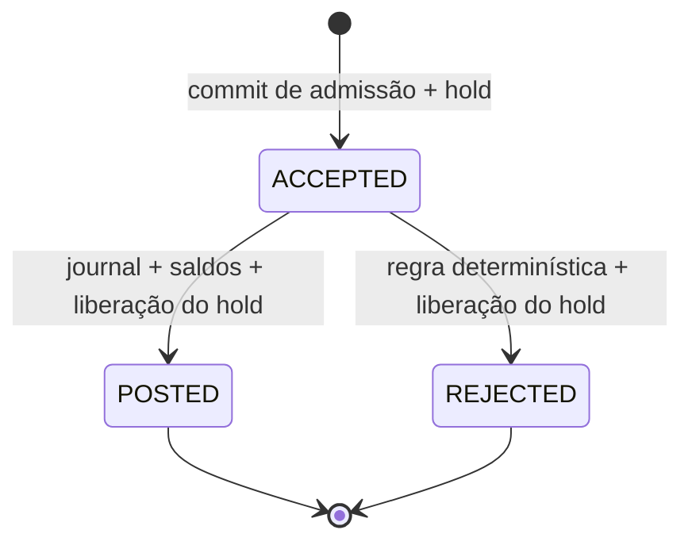
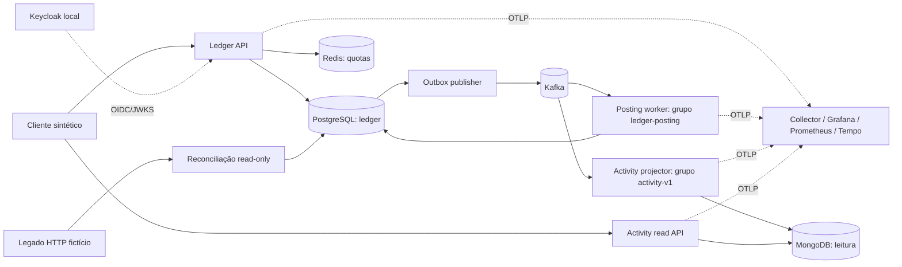

# Distributed Transaction Processing Platform — proposta para aprovação

Data do plano: 11/10/2026. Atualização14/10: **F0–F6 locais concluídas; F3–F8 aprovadas explicitamente. F7 seguinte.** O restante descreve a arquitetura alvo; não comprova implementação de componentes futuros. Estado real e evidências: [PROGRESSO.md](PROGRESSO.md), [matriz](REQUIREMENTS_MATRIX.md) e validações no projeto.

## 1. Decisão recomendada

Construir um **ledger de transferências sintéticas com processamento assíncrono e projeção reconstruível**. Nome de apresentação sugerido: **DTP — Synthetic Ledger & Transaction Processing**. “Distributed Transaction” deve significar processamento entre processos e stores, não atomic commit distribuído/XA.

A sugestão original de uma plataforma genérica de transações é ampla demais: sem produto, invariantes e consulta, vira CRUD com fila. O recorte proposto tem um operador de laboratório que cria contas fictícias, envia transferências, observa o resultado e reconstrói uma visão de atividade após falha. Um auditor consulta lançamentos e encontra divergência com um extrato legado simulado. Não há PIX, cartão, PSP real, fraude real, liquidação bancária, dados pessoais reais ou certificação regulatória.

O diferencial frente aos Fulfillment Hubs será:

- Invariantes de saldo/reserva e lançamentos compensatórios imutáveis, além de estado de pedidos.
- Kafka com processamento e leitores em **grupos independentes**, mais replay de uma projeção sem repetir o efeito financeiro.
- Um read store privado com propriedade e recuperação próprias; perda de MongoDB não invalida o ledger.
- OIDC/Keycloak, autorização por tenant/conta e limites globais em duas réplicas.
- Evidências de concorrência, falhas entre commits, lag e performance local.

Os Hubs já cobrem outbox, idempotência, SQL, SQS, providers e deploy AWS. Reutilizar conhecimento é adequado; copiar workflows, código ou infraestrutura não é necessário. A auditoria desta conversa fornece os limites que o terceiro projeto deve evitar, sobretudo rede dentro de transação e claims sem ownership.

## 2. Pesquisa de mercado e escopo defensável

[PESQUISA_E_FONTES.md](PESQUISA_E_FONTES.md) registra oito vagas lidas e classificadas. [REQUIREMENTS_MATRIX.md](REQUIREMENTS_MATRIX.md) mapeia 52 grupos de requisitos/objetivos, todos pendentes, incluindo exclusões. Não há percentual de cobertura implementada.

As cinco vagas fornecidas confirmam combinações variadas de Java/Spring, persistência, APIs, testes e operação. Kafka aparece como diferencial em Cedro e People Partners; Nava não separa requisitos de responsabilidades. As adicionais CashMe, Bradesco e Sicredi reforçam fundamentos/testes, Boot 4/OIDC e Kafka/Kubernetes, respectivamente. Nenhuma vaga isolada justifica somar toda a lista de tecnologias. [Vagas e classificações](PESQUISA_E_FONTES.md#vagas-e-classificação)

**O que este projeto não cobrirá:** Oracle/SQL Server/MySQL, protocolo FIX, integração real com mainframe, Open Finance, Azure, Vue/React, BFF sem cliente específico e múltiplos brokers simultâneos. Os Hubs podem sustentar a experiência de laboratório SQS; isso não autoriza marcar SQS como implementado no DTP. Anos de profissão, mentoria, equipes e operação de banco não se provam por um repositório.

## 3. Produto, invariantes e casos de uso

### Escopo funcional

1. Contas sintéticas criadas por seed explícito, com saldo inicial registrado por lançamentos de financiamento.
2. `POST /v1/transfers`: valida e admite transferência de valor positivo, mesma moeda e mesmo tenant, com Idempotency-Key. A admissão reserva fundos.
3. Processamento assíncrono aplica uma regra determinística versionada e confirma ou rejeita a transferência.
4. Consulta autoritativa de saldo/reservas/estado no ledger SQL; consulta eventual de histórico/recibo na read API.
5. Estorno solicitado por operador cria **nova transferência inversa**, vinculada à original. Não apaga lançamentos nem promete estorno se o destinatário já gastou os fundos.
6. Reprocessamento operacional autenticado, reconciliação de pendências e rebuild da leitura.
7. Comparação read-only com relatório fictício de um legado HTTP, gerando divergência operacional; nenhuma divergência altera automaticamente saldo.

Começar com BRL em centavos e transferências internas. Várias moedas, FX, taxas, contas externas, saque, emissão de crédito e clearing ficam fora. Isso permite testar integridade sem fingir implementar um banco.

### Invariantes propostas para aprovação

| ID | Invariante | Enforcement planejado |
|---|---|---|
| I1 | Valores inteiros de centavos, positivos, moeda admitida; sem float/overflow | Money value object, limites de entrada e constraints |
| I2 | Em cada journal, soma dos lançamentos assinados é zero na moeda | Serviço de posting, transaction SQL, guard/constraint trigger diferida a avaliar e IT de acesso direto |
| I3 | Cliente possui `balance >= reserved >= 0`; disponível = balance − reserved | Locks e CHECK; soma dos holds ativos deve coincidir com reserved |
| I4 | POSTED debita origem e credita destino atomicamente | Duas contas, journal, estado, inbox e outbox no mesmo commit |
| I5 | Uma operação lógica produz no máximo um journal principal | Índice único por transferId, chave idempotente e transição condicional |
| I6 | Toda ACCEPTED possui hold; POSTED/REJECTED não mantêm hold ativo | Constraints/serviço e reconciliação; reservar/liberar no mesmo commit de estado |
| I7 | Nenhuma redelivery, replay ou retry cria débito/crédito adicional | Dedup e guard por estado/journal, testados com crashes |
| I8 | Estados terminais não regridem; reversão é nova operação | Máquina de estados e referência única de reversão bem-sucedida |
| I9 | Chave já associada não aceita outro payload | Índice e hash permanente para identidade lógica; retenção de resposta é separada |
| I10 | Ledger é autoritativo; read store/cache podem estar atrasados | Contratos separados com versão e timestamp de projeção |
| I11 | Tenant e propriedade de conta não podem ser escolhidos pelo payload | Claims validados + ownership persistido; filtros no ledger/read |
| I12 | Todo efeito commitado tem evento canônico durável | Evento imutável + outbox atomizados na mesma transação |

Saldo inicial não será uma atualização ad hoc: journal de financiamento entre conta técnica e cliente. A conta técnica pode ter saldo assinado negativo como contrapartida fictícia; a regra I3 aplica-se a contas de cliente. A soma global dos postings continua zero. Essa distinção deve aparecer em schema e testes, sem backdoor para o usuário transferir de conta técnica.

O saldo materializado SQL deve bater com a soma do journal; como CHECK comum não agrega outras linhas, não basta escrever CHECK e alegar I2/I3 globais. Serviço e testes diretos são obrigatórios; uma constraint trigger diferida pode reforçar soma por journal e integridade da materialização, com custo medido. O ledger é de dupla entrada educativa, não contabilidade certificada.

### Estados e respostas HTTP

Erro estrutural/auth não cria operação: 400/401/403. Fundos insuficientes ou conflito antes de admissão retornam erro de negócio definido no contrato, sem hold parcial. Uma admissão válida responde 202 e Location de status. Repetição da mesma chave/hash retorna a mesma admissão, mesmo se o estado atual já for terminal; status atual se consulta por GET. Outro payload com mesma chave retorna 422. Resultados da regra assíncrona podem ser REJECTED apesar do 202: aceitação não é confirmação financeira.

Falha técnica não é estado financeiro REJECTED. É retry/quarentena operacional enquanto ACCEPTED. Hold não expira automaticamente por relógio: cancelamento operacional de pendência, se incluído, será transição transacional concorrente com posting, com auditoria e evento. O primeiro terminalizador válido vence.

A regra determinística é fictícia, por exemplo um limite de valor e flag de cenário explicitamente reservado a fixture. Persistir versão e parâmetros da regra na admissão. Não usar sorteio, relógio mutável ou perfil HTTP instável para decidir retrospectivamente um replay.

## 4. Arquitetura e responsabilidades

### Topologia proporcional

**Três executáveis:** ledger-api; ledger-worker (publisher, posting e jobs); activity-service (projector + read API). API/worker compartilham o bounded context e banco ledger. Activity possui store privado, contrato de consumo e escala próprios; não consulta diretamente tabelas PostgreSQL nem participa de gravações financeiras. Não chamar cada módulo técnico de microsserviço.

Activity é uma capacidade derivada, não um segundo sistema financeiro. Sua separação é uma decisão pedagógica justificada por replay, isolamento de carga e indisponibilidade independente; em um produto pequeno real, projeção SQL no mesmo monólito seria alternativa muito razoável. Esse custo será explicitamente comparado no benchmark.

### Módulos Maven planejados

| Módulo | Responsabilidade | Dependências permitidas |
|---|---|---|
| ledger-domain | Money, Account, Transfer, Hold, Journal e policies | Java puro, sem Spring/JPA/Kafka |
| ledger-application | Admit/Process/Reverse/Reconcile; ports | Domain, contratos mínimos |
| ledger-adapters | PostgreSQL/JPA, outbox, Kafka, Redis, HTTP legado | Application/Domain, frameworks |
| ledger-api | HTTP, validação/auth e composição | Application e adapters |
| ledger-worker | Kafka consumer, publisher e composição de jobs | Application e adapters |
| event-contracts | Envelope/schema e compatibilidade | Sem entidades JPA ou classes internas de domínio |
| activity-service | Consumo/read, Mongo e composição | event-contracts; não ledger-adapters/domain |

Pacotes por capacidade e ports/adapters dentro do contexto. Ports representam necessidades concretas, não IRepository genérico. Adapters JPA não vazam EntityManager/entidades para a API. DTOs imutáveis; transações curtas no caso de uso. ArchUnit valida direção das dependências e a propriedade do read store. Não usar Spring Cloud, Eureka, Config Server ou Gateway apenas porque há três processos.

### Admissão e posting: fronteira transacional

**Admissão:** autenticar/autorizar → quota auxiliar → abrir transação SQL → obter chave idempotente concorrente → bloquear contas em ordem canônica `(tenant,id)` → validar saldo → criar hold/transfer ACCEPTED → armazenar resposta de admissão, evento e outbox → commit → responder. Nenhuma rede dentro dessa transação. Conflito na chave resolve por índice/lock; não capturar qualquer unique violation como se fosse duplicata legítima.

**Posting:** receber TransferAccepted → validar schema → abrir transação SQL → reservar dedup para esse evento/operação → bloquear transferência/contas na ordem definida → se já terminal, no-op seguro → aplicar política versionada → journal+saldos+liberação de hold+estado terminal+evento/outbox+dedup → commit → confirmar offset. Crash após commit e antes de offset resulta em redelivery/no-op. Crash antes de commit não deixa efeito parcial.

Estratégia inicial: locks SQL por conta para dar clareza à reserva; concorrência otimista é uma alternativa para testar quando houver distribuição/contenda conhecida. Ordem consistente vale também para seed, reversão e jobs. Retry de deadlock/serialization é limitado e só repete a transação abortada; não reexecuta efeito externo.

Uma transferência toca duas contas que podem participar de transações em partições Kafka diferentes. **Kafka não garante serialização de ambas as contas.** Correção depende do PostgreSQL e dos locks, não da chave de partição. Conta quente limita paralelismo: será medida, não escondida com mais consumers.

## 5. Kafka, outbox, contratos e recuperação

### Casos de uso reais para Kafka

O grupo `ledger-posting-v1` processa admissões; `activity-v1` constrói leitura. Pausar/reconstruir Activity não para posting nem consome mensagens dele. Esse requisito de grupos/offsets e replay é o ganho específico que não existia no núcleo dos Hubs. PostgreSQL permanece a autoridade; Kafka transporta fatos duráveis e trabalho decorrente deles. [Kafka: design/entrega](https://kafka.apache.org/41/design/design/)

Tópico inicial `dtp.transfer-events.v1`, chave `(tenantId, transferId)`, três partições **como escolha de laboratório**, não dimensionamento de produção. Um evento carrega `eventId`, `eventType`, `schemaVersion`, `aggregateId`, `aggregateVersion`, `occurredAt`, `tenantId`, correlation/context e payload suficiente para a projeção. O worker só trata Accepted; terminalizações alimentam leitores. Contratos não carregam segredo, JWT ou PII real.

Payload terminal contém snapshot completo do recibo/estado, não só ID que exigiria consultar o ledger. Ledger mantém journal e eventos canônicos imutáveis. Kafka tem retenção finita; não é um event store infinito. Planejar 7 dias localmente, explicitar parâmetro e guardar os eventos SQL enquanto o dataset de laboratório existir. Rebuild anterior à retenção usa exportação canônica versionada/assinada por checksum, não acesso SQL direto da Activity.

### Outbox

Evento canônico e delivery record são criados no mesmo commit do efeito. Publisher faz claim curto com lease/owner, publica com confirmação (`acks=all`/producer idempotente quando compatível) e só depois marca entregue. Falha na confirmação pode gerar publicação duplicada: entregar pelo menos uma vez é o contrato.

Não marcar publicado antes de enviar, nem manter lock SQL durante publish. Owner vencido não pode finalizar claim novo; antes de enviar verificar ownership e deadline, renovar conforme budget. Mesmo assim, pausa do processo pode causar publish duplicado, então consumidores continuam idempotentes.

Ordenar claims por agregado/versão e não liberar versão posterior antes da confirmação anterior. Isso ajuda ordem normal, mas duplicatas tardias/lease/replay exigem guard por versão no consumidor. Não afirmar que `ORDER BY created_at` com vários publishers estabelece ordem por si só.

### Retry, DLQ e ordem

- Falhas transitórias SQL/infra: retry limitado com backoff/jitter, deadline e pausas que não excedam os limites do consumer sem controle. Evitar `sleep` indefinido no listener; pause/poll/heartbeat precisam ser testados com rebalance.
- Mensagem inválida/versão não suportada: quarentena em DLT com bytes limitados, erro sanitizado, identidade e tópico/offset originais. Comprovar publicação da DLT antes de confirmar o offset original. Se DLT estiver indisponível, não descartar.
- Para posting, não usar retry topics como se preservassem ordem original; começar com retry que pausa a partição. O efeito financeiro continua protegido por DB mesmo após quarentena.
- Para Activity, retries em tópicos podem ser aceitos após teste de duplicatas/ordem, porque snapshots são guardados por versão e histórico é idempotente. Isso troca ordem de chegada por convergência, declaradamente.

A documentação Spring Kafka descreve que a estratégia de retry topics pode perder as garantias de ordem do tópico; verificar APIs/configuração na linha efetivamente usada. [Semântica de retry](https://docs.spring.io/spring-kafka/docs/3.0.x/reference/html/)

### Reprocessamento não é replay financeiro

Replay normal cria uma nova projeção, usando outro consumer group e store/collection de destino. **Nunca resetar offsets do grupo de posting para “reconstruir saldos”.** Ledger financeiro é reconstruído/checado por journal SQL e procedimento próprio.

Reprocessar DLT é uma operação de operador, com motivo, alvo e auditoria; preservar eventId/transferId quando for a mesma operação. Não gerar nova identidade para contornar dedup. Antes de requeue, validar se já terminalizou. Repair de evento malformado deve ter trilha e obter dados canônicos do ledger; nenhuma edição silenciosa do fato histórico.

Job de reconciliação procura ACCEPTED antigos e aciona o mesmo ProcessTransfer idempotente. Isso não deve se tornar um caminho que mascara perda de mensagens sem métrica: contar recuperação, motivo e idade. Holds ligados a pendências continuam visíveis e geram alerta; não liberar automaticamente enquanto um commit concorrente ainda pode ocorrer.

### Evolução de contratos

Começar com JSON + JSON Schema versionado no repo, validado por testes old/new consumers. Campo opcional com default permite evolução; mudar significado/unidade/identificador exige nova versão/estratégia. Avro/Schema Registry são adiados até haver requisito de registry/compatibilidade centralizada; podem entrar em laboratório específico. Não publicar entidade JPA diretamente.

## 6. PostgreSQL, MongoDB e Redis: autoridade e acesso

### PostgreSQL — ledger

Tabelas previstas: accounts, transfers, holds, journals, journal_entries, admission_keys, inbox_messages, canonical_events, outbox_deliveries e operational_audit. Índices para idempotência, journal por operação, holds ativos, transações por conta/tempo e due outbox. CHECKs de limites e FKs compatíveis com o modelo; orçamento de lock/statement; Flyway em job único, nunca migration concorrente em cada réplica.

Idempotência: resposta HTTP pode expirar depois de 24 horas, mas associação/hash da operação financeira continua protegida pelo horizonte de retenção do ledger. Após expiração da resposta, recuperar a identidade ou exigir chave nova conforme contrato; nunca retornar sucesso antigo para payload diferente. Todos os campos relevantes entram no hash canonicalizado. Não reservar a chave em transação separada sem owner/lease e recuperação.

### MongoDB — activity/recibo derivado

Padrão de acesso: obter recibo completo por transação; listar atividade do tenant/conta por cursor; consultar eventos e motivos por categoria. Snapshot documental tem detalhes de decisão/reconciliação com shapes diferentes e versão de projeção. Essa é a justificativa de aprendizado documental; **PostgreSQL JSONB poderia resolver o mesmo padrão** com menor operação. Mongo precisa provar isolamento/rebuild e custo, não se vender como necessariamente mais rápido.

Modelo inicialmente proposto: `activity_snapshots` por `(tenant,transfer)` com snapshot e aggregateVersion; `activity_events` com chave única `(tenant,eventId)` e índice por agregado/versão. Não anexar histórico ilimitado em array do snapshot.

Processamento: upsert do evento idempotente → atualização do snapshot apenas se versão mais nova → confirmação Kafka. São duas operações: se o processo cair entre elas, redelivery executa **ambas**, inclusive update de snapshot quando evento já existir. Não tratar duplicate insert como autorização para pular atualização. Payload final é autossuficiente, então v2 antes de v1 não regride o snapshot; v1 pode completar o histórico depois. Se futuramente exigir visibilidade atômica de evento e snapshot, usar transação Mongo em replica set e aceitar seu custo. [Atomicidade](https://www.mongodb.com/docs/manual/core/write-operations-atomicity/) / [unicidade](https://www.mongodb.com/docs/manual/core/index-unique/)

Read API retorna estado/versão da projeção e horário de atualização. 404 pode significar “não projetado”; cliente consulta status autoritativo no ledger com sua permissão. Rebuild em collection nova, catch-up medido e troca controlada do destino; nenhuma autorização deve confiar somente no fato de o documento existir. Perder Mongo não altera saldos.

### Redis — auxiliar

Uso principal: rate limit por tenant/client autenticado, compartilhado por duas APIs. Operação de incremento e TTL atômica, política de quota/erro e limites de cardinalidade. Redis fora do ar: mutações retornam indisponibilidade controlada (fail-closed para proteger a quota global); leituras podem ter política local limitada documentada. Não cachear “autorizado” para ignorar checagem de ownership. [Contador e expiração](https://redis.io/docs/latest/commands/incr/)

Cache distribuído é **condicionado a benchmark**, não obrigatório por estar na lista. Candidato: recibo terminal imutável por `(tenant,transfer,projectionVersion)`, com validação auth antes do hit e TTL. Nunca saldo disponível ou resultado de regra financeira como autoridade. Demonstrar cache frio/quente, expiração, indisponibilidade e invalidação/troca de versão; abandonar se ganho não compensar.

## 7. Stack recomendada e exclusões

| Área | Escolha | Justificativa/condição |
|---|---|---|
| Runtime | Java 21 + Spring Boot 4.1.x | Estável compatível e suporte OSS; patch revalidado no scaffold |
| HTTP | MVC/Web, Bean Validation, OpenAPI API-First | Contrato explícito; sem WebFlux com JDBC bloqueante por aparência |
| SQL | Spring Data JPA/Hibernate, PostgreSQL, Flyway | Transações/invariantes; SQL explícito quando query/lock exigir |
| Build | Maven Wrapper e BOM Boot | Familiaridade dos Hubs e reprodução; sem versões arbitrárias de Spring |
| Kafka | Spring Kafka + broker KRaft local | Grupos independentes e replay; versão/image fixadas após compatibilidade |
| Eventos | JSON Schema versionado | Evolução testável sem registry extra inicial |
| Mongo | Spring Data MongoDB | Read store reconstruível; comparar alternativa JSONB |
| Redis | Spring Data Redis/Lettuce | Quota global; cache apenas se medido |
| Auth | Spring Security Resource Server + Keycloak | OIDC padrão e keys assimétricas; sem framework de login próprio |
| Resiliência | Resilience4j no adapter legado | Circuit/deadline/bulkhead em necessidade HTTP concreta; starter Boot só se compatível |
| Observabilidade | OTel + Micrometer + Collector, Prometheus/Grafana/Tempo | Contexto desde fundação, drill e sinais de negócio |
| Qualidade | Jupiter do BOM, Mockito, AssertJ, Testcontainers, WireMock, ArchUnit, JaCoCo | Cada ferramenta ligada a fronteira/invariante |
| Performance | k6, SQL explain, JFR/GC logs | Baseline, não números de marketing |
| Infra local | Docker/Compose + Kind/Minikube; Helm da aplicação | Desenvolvimento/recovery; dependências locais não são blueprint de HA |
| Infra futura | Terraform modular ECS/Fargate | Artefato estático; nenhum recurso/deploy |
| CI | GitHub Actions, CodeQL, dependency/secret/image scan | Gates reais e artifacts; sem credentials cloud |

Spring Boot 4.1.1 consultado aceita Java 21; Boot 3.5 encerrou sua linha OSS. [Compatibilidade](https://docs.spring.io/spring-boot/system-requirements.html), [suporte 3.5](https://spring.io/blog/2026/06/25/spring-boot-3-5-16-available-now/). O patch exato e matriz de versões serão registrados no build após aprovação. JUnit 5 é candidato do pedido; não piná-lo isoladamente contra BOM/test stack de outra geração. O objetivo é manter Jupiter/Mockito/Testcontainers em conjunto suportado.

**Adiados:** RabbitMQ/SQS adicionais, gRPC, Elasticsearch, CDC/Debezium, Schema Registry, Kafka Streams, CQRS framework, event sourcing financeiro, XA/2PC, service mesh, Argo CD, Terraform EKS e múltiplas nuvens. CQRS como separação de leitura está no desenho, sem framework obrigatório. Helm só entra na fase local porque três executáveis/configurações e overlays justificam parametrização.

Virtual threads Java 21 são um experimento de performance posterior: podem melhorar ocupação de threads sob I/O, mas não criam conexões JDBC, throughput por conta quente ou segurança de EntityManager compartilhado. Não usar preview features, ThreadLocal com contexto perdido ou parallelStream para transações.

## 8. Segurança e observabilidade

### Segurança desde a fundação

Keycloak local em perfil próprio, credenciais geradas/externas e dados fictícios. Resource servers validam assinatura, issuer, expiração e audience explícita, mapeiam roles/scopes e não confiam em payload para tenant. Testes usam issuer real para a fronteira completa e JWTs controlados nos slices. [Spring JWT](https://docs.spring.io/spring-security/reference/servlet/oauth2/resource-server/jwt.html), [Keycloak](https://www.keycloak.org/securing-apps/oidc-layers)

Papéis: `transfer-client` admite a partir de conta própria; `auditor` lê histórico autorizado; `operator` pode reprocessar/solicitar reversão com motivo; `admin` gerencia configuração de laboratório, sem permissão financeira implícita irrestrita. Toda query possui escopo tenant e autorização de conta, inclusive cache/read store. Conta técnica é protegida.

Tokens curtos, JWKS cache e rotação testada; logout não promete revogação instantânea de JWT já emitido. Se isso virar requisito, especificar introspecção/revogação e dependência de disponibilidade em ADR. Nunca usar token de usuário como identidade transportada no evento. Componentes usam identidade técnica e ACLs por grupo/tópico. Topics locais podem ser simples no primeiro profile, mas profile de segurança deve demonstrar SASL/TLS/ACL ou deixar isso pendente explicitamente.

Threat model: transferência não autorizada, escape entre tenants, chave idempotente abusada, reprocessamento indevido, replay histórico confundido com comando, mensagens malformadas, secrets/logs, quotas e interrupções parciais. Proteger payload size, unknown schemas, timeouts e body parsing. Ambiente local expõe dependências em loopback; não publicar Mongo/Redis/Kafka/Actuator/admin indiscriminadamente.

### Sinais e critérios

- Logs JSON sanitizados com service, trace/span e correlation; nenhum JWT, segredo, corpo completo ou token.
- Contexto criado no servidor mesmo sem header de cliente, persistido no outbox e extraído pelo consumer; spans não são substituídos por MDC.
- Counters de admissões/terminalizações **commitadas**, outcomes/retries/dedup/reprocessamentos; evitar contar rollback como sucesso.
- Histogramas de HTTP, posting, admission-to-terminal e projeção; p50/p95/p99 com buckets adequados.
- Lag por consumer group/partição, idade do ACCEPTED/hold mais antigo, backlog outbox, DLT, pool SQL, lock wait, heap/GC e ocupação de bulkhead.
- Identificadores de transação/usuário em traces/logs de acesso restrito, nunca labels de métricas de alta cardinalidade.
- Alertas para pending antigo, atraso do leitor, DLT e falha persistente; runbooks de diagnóstico e recovery. Um ensaio local precisa mostrar firing/resolved.

As opções de stack local serão enxutas: perfil core, perfil read+quota e perfil observability, evitando exigir toda a infraestrutura para testes unitários. Memória e limites iniciais serão calibrados com o hardware real. Não prometer que a stack completa funciona em qualquer notebook sem medir.

## 9. Roadmap incremental e esforço

Segurança básica, context propagation e isolamento de teste começam cedo; não deixá-los para depois de todos os bancos. Evoluir um caminho vertical verificável por vez. Cada fase exige aprovação dentro do escopo acordado, testes e revisão; falhas em invariantes impedem avanço.

Estimativas: uma pessoa com experiência prática em Java/Spring, trabalhando 6 horas focadas/dia. “PoC” prova fluxo feliz e hipótese; “robusto local” inclui falhas, revisão, documentação e evidência. Somar fases não equivale a horas de operação em produção. Curva de aprendizado pode acrescentar 25–40%.

| Fase | Entrega / dependências | PoC | Robusto local | Aceitação verificável |
|---|---|---|---|---|
| F0 | Contratos, ADRs, invariantes e versions; aprovação | 1–2 d | 3–4 d | Arquitetura aceita, API/event schemas e exclusões definidos |
| F1 | Domínio/API/SQL/Flyway, teste isolado, auth mínimo; F0 | 3–5 d | 8–12 d | Admission + hold atômicos; hash/chave concorrente; tenant/ownership; migrations do zero; testes I1–I3/I9/I11 |
| F2 | Outbox/Kafka/posting/idempotência/retry/DLT; F1 | 4–6 d | 12–18 d | I4–I8/I12, crashes pré/pós-commit, ack perdido, broker down e recovery |
| F3 | Activity Mongo, grupos/rebuild; Redis quota; F2 | 3–5 d | 8–12 d | Grupo independente; replay igual; versão não regride; queda entre writes Mongo; limite global duas APIs |
| F4 | OIDC completo, RBAC/ACLs, legado e resiliência; F1–F3 | 2–4 d | 6–9 d | Issuer/audience errados recusados; cross-tenant falha; rotação; breaker abre/fecha; bulkhead isola |
| F5 | OTel/métricas/dashboard/alertas/runbooks; instrumentação iniciada F1 | 2–3 d | 5–8 d | Trace real atravessa Kafka; ingestão dos três sinais; alertas disparados/resolvidos |
| F6 | k6/profiling, concorrência/tuning; F2–F5 | 2–3 d | 5–8 d | Baseline repetível, queries/plans e saturação; invariantes após carga; cache opcional com comparação |
| F7 | Containers finais, Kubernetes/Helm, Terraform estático e AWS guide; F1–F6 | 3–5 d | 7–11 d | Compose completo, pod recovery/draining; lint/template/validate/test; sem deploy externo |
| F8 | E2E/security review, demo, matriz auditada e release local; anteriores | 2–3 d | 5–8 d | Demo reproduzida, testes/gates atuais, limitações e riscos residuais explícitos |

Totais aproximados: **22–36 dias para PoCs**, **59–88 dias para acabamento robusto local**. A 30 h/semana isso equivale aproximadamente a 12–18 semanas focadas para robusto local; a 10 h/semana, 36–53 semanas. Não tratar o total PoC como compromisso para todas as garantias. F0 pode aproveitar o planejamento desta etapa após revisão.

MVP defensável: F0–F2, sem Mongo/Redis antes de ledger confiável. Release de portfólio completo: F0–F8. Se prazo apertar, cortar cache e laboratórios extras; não cortar isolamento, segurança de conta e testes de falha.

### Testes por camada

| Camada | O que comprova | Ferramenta / evidência |
|---|---|---|
| Unit | Money, máquina de estados, invariantes e política versionada | Jupiter/AssertJ; Mockito só para ports |
| HTTP slice | Validação, status, erros e auth mapping | Spring test slices, DTO/schema |
| SQL IT | Transactions, índices/constraints, deadlock, holds/journal | Testcontainers PostgreSQL + conexões reais/barreiras |
| Kafka IT | Grupos, offsets, duplicates, rebalance e DLT | Testcontainers Kafka + consumers reais |
| Mongo/Redis IT | Replay, write parcial, quota global/TTL e queda | Containers exclusivos por suíte |
| OIDC/HTTP IT | Assinatura real, JWKS, roles, legado slow/error | Keycloak container, WireMock |
| Architecture/contract | Direção de dependências e old/new schemas | ArchUnit e validação de contratos |
| E2E | Três executáveis, auth real e estado final | Compose isolado/HTTP; sem teste em cloud |
| Fault/recovery | Crash points entre etapas, perda de ack e replay | Processes isolados, barreiras/hooks de teste; Toxiproxy só para falha TCP necessária |

Não escolher percentual de cobertura para impressionar. JaCoCo mede branches e aponta lacunas, especialmente nas transições e falhas; invariantes/contratos são os gates. Não executar TRUNCATE em banco externo apontado por URL de desenvolvimento.

### Cenários mínimos de recuperação

1. Cem requisições com mesma chave: uma admissão/hold, resultado coerente para todas.
2. Várias transferências de contas com último saldo disponível: nenhuma violação de reserva; resultados válidos, sem saldo negativo.
3. Transferências A→B e B→A concorrentes: ordem de locks, retry limitado e invariantes após término.
4. Crash após journal commit antes de ack Kafka: redelivery sem segundo journal.
5. Crash publisher após ack remoto antes de marcar outbox: evento duplicado seguro.
6. Mongo grava evento e cai antes de snapshot: repetir completa snapshot; versão antiga não sobrescreve a nova.
7. Broker/read store/Redis fora do ar: distinguir admission durável, posting atrasado, leitura atrasada e quota indisponível.
8. Poison record/DLT indisponível: nenhum descarte silencioso; reprocessamento auditado.
9. Apagar apenas store da nova projeção: rebuild alcança equivalência de documentos/versões/checksum.
10. Restaurar SQL de backup de laboratório e reconciliar journal/saldos/holds; explicar retenção de eventos e retomada de offsets.

### Benchmarks e metas

Separar admission HTTP, posting e consulta de Activity. Dataset proposto: 10 mil contas e 100 mil transferências sintéticas, mais cenário de conta quente; tamanhos podem ser reduzidos após checar hardware. Registrar CPU/RAM/disco, imagens/digests, versões, pools, partições, sampling e seeds.

Executar aquecimento, taxa de chegada progressiva e três repetições. Medir percentis, throughput concluído, rejeições esperadas separadas de 5xx/timeout, dropped iterations, DB lock wait, lag e tempo para drenar. O gerador também precisa de headroom. [k6](https://grafana.com/docs/k6/latest/using-k6/thresholds/)

A fase F6 deve fixar um envelope demonstrativo após baseline e justificar SLO, em vez de prometer “milhões de transações”. Gates invariantes são absolutos no cenário; latência/capacidade dependem do hardware. Comparar queries antes/depois, 1 vs 2 API/worker, hot/cold cache se adotado, Mongo vs read adapter SQL em experimento pequeno quando o esforço compensar. Não declarar speedup sem resultado bruto.

## 10. Infraestrutura AWS-ready sem deploy

**Nenhum recurso será criado e nenhum deploy AWS será executado.** Preparação não é validação de execução em cloud. Nesta etapa há somente o plano; Dockerfiles/manifests/chart/Terraform só serão escritos após aprovação das fases.

### Escolha futura

Recomendar **ECS com Fargate para aplicação**, em vez de EKS. Kafka e os bancos não viram tasks efêmeras sem persistência. Kafka gerenciado (MSK) e PostgreSQL gerenciado (RDS) são candidatos futuros; Redis gerenciado e Mongo contratado/externalizado dependem de dimensionamento e conectividade. Não assumir DocumentDB drop-in para Mongo: driver, índices e operações teriam que ser homologados.

Fargate é capacidade de execução e pode servir ECS/EKS; a comparação correta aqui é ECS/Fargate contra EKS com seu compute. ECS reduz operação de cluster para três executáveis; Kubernetes local continua sendo aprendizado de probes/rollout/recuperação. [Guia AWS](https://docs.aws.amazon.com/decision-guides/latest/decision-guides/choosing-aws-container-service.html)

Blueprint: VPC/subnets privadas/security groups → ALB/HTTPS para APIs → tasks com roles próprias → RDS/MSK/Redis/Mongo privados → secret references → OTLP collector/logs com retenção → ECR artifacts. IdP precisa de banco e estratégia própria; não chamar Keycloak dev mode de HA. Se no futuro houver requisito de HA, multi-AZ e redundância de brokers/bancos/IdP/collector entram na estimativa, não só `replicas: 2`.

### Entregas planejadas F7

- Dockerfiles multistage Java 21, não-root, digests e health checks; limites e graceful shutdown.
- Compose com projetos/volumes isolados, perfis e jobs de migrate/seed; sem passwords reais versionados.
- Chart Helm da aplicação com values local/test/future, probes diferenciadas, resource requests/limits, env/secret refs, migration Job sequenciado e drain no shutdown.
- Kafka, PostgreSQL, Mongo, Redis e Keycloak locais como dependências de laboratório; manifests não alegam robustez de banco de produção.
- Escala de consumer limitada por partições e orçamento DB; API/reader por CPU/latência; medir lag antes de escolher KEDA/HPA por lag. Não escalar acima do limite de conta quente como solução de consistência.
- Terraform com módulos pequenos por lifecycle: network, application/identity-access, data/messaging; roots por ambiente. Nada de módulos genéricos vazios ou EKS paralelo sem necessidade.
- `terraform fmt`, `init -backend=false`, `validate`, tests com providers mockados e scans estáticos. Não executar plan que consulte conta nem apply; se checks exigirem cloud, registrar pendência.
- Pipeline build/test/contracts/security/image/package; artifacts e GitHub Actions com menor permissão. Sem job cloud, access key ou OIDC de deploy habilitado.
- Script local de validação e deploy no cluster local; para AWS, guia e render de instruções sem execução automática. Qualquer script futuro deve recusar alvos cloud neste projeto enquanto a proibição persistir.

Readiness depende da capacidade necessária: ledger-api precisa SQL e, para mutação/quota, Redis segundo política; broker indisponível pode deixar posting atrasado, sem remover todas as APIs indevidamente. Liveness verifica processo, não health de Kafka/SQL, para evitar restart storm. Worker registra progresso e pode pausar consumption/retry; não usar arquivo de heartbeat eterno como evidência de trabalho saudável.

### Rollback e recuperação

Imagens imutáveis e rollout gradual; migration expand-contract compatível com versões coexistentes. Rollback de app não desfaz journal nem apaga schema/data. Pausar consumer se incompatibilidade, restaurar versão anterior compatível com eventos/schema e conservar offsets; não resetar grupo financeiro. Testar shutdown e rebalancing para commitar antes de ack.

Rebuild de Activity usa collection/group novos e switch controlado. Backup SQL/restore isolado deve checar postings, holds e dedup e planejar replay de outbox sem efeito duplicado. RPO/RTO serão medidos no laboratório, não anunciados de antemão.

### Estimativa de custos futura, explicitamente parcial

Custo incremental de recursos cloud nesta execução: **US$ 0 criado pelo projeto**, pois não haverá provisionamento. Isso não inclui assinatura do usuário, energia/hardware ou limites de CI, e não presume Free Tier.

Cenário ilustrativo 24×7, região us-east-1, 730 h/mês, sem descontos/impostos, preços públicos consultados em 11/10/2026:

| Item hipotético | Premissa | Cálculo aproximado |
|---|---|---|
| Fargate Linux x86 | 4 tasks (API, worker, Activity, IdP), cada uma 0,5 vCPU/1 GiB | `4 × 730 × (0,5 × 0,0404784 + 1 × 0,004446)` ≈ **US$ 72,08/mês** |
| MSK provisionado | 3 brokers kafka.m7g.large a US$ 0,204/h; 100 GB por broker a US$ 0,10/GB-mês | `3 × 730 × 0,204 + 300 × 0,10` ≈ **US$ 476,76/mês** |
| EKS se escolhido | Control plane em suporte padrão, compute separado | `730 × 0,10` = **US$ 73/mês adicionais** |

São cálculos sobre preços unitários dos exemplos oficiais, **não sizing validado nem cotação da arquitetura completa**. Fargate 1 GiB pode ser insuficiente para os hosts sob carga e será recalibrado; MSK acima é cenário ilustrativo e não afirma ser a menor configuração viável. [Fargate](https://aws.amazon.com/fargate/pricing/), [MSK](https://aws.amazon.com/msk/pricing/), [EKS](https://aws.amazon.com/eks/pricing/)

Subtotal conhecido ECS/Fargate + cenário MSK: aproximadamente **US$ 548,84/mês**, ainda sem RDS/armazenamento/backup, banco do IdP, Redis, Mongo, ALB, NAT ou VPC endpoints, IPv4, transferência, ECR, observabilidade e DNS. EKS acrescenta o control plane além desses componentes. Não apresentar esse subtotal como custo final. [RDS](https://aws.amazon.com/rds/postgresql/pricing/), [ElastiCache](https://aws.amazon.com/elasticache/pricing/), [DocumentDB como alternativa a homologar](https://aws.amazon.com/documentdb/pricing/)

O total exigiria selecionar SKUs, retention, AZs, tráfego e sizing em calculadora pública antes de qualquer reconsideração futura de cloud. Não há razão para pagar esse stack só pelo portfólio; a recomendação permanece execução local e blueprint estático. A escolha MSK Serverless, menor EC2 ou broker self-hosted muda custos/garantias e requer análise própria; não declarar “serverless é grátis quando parado”.

### O que continuará não comprovado

IAM real/quotas/networking de conta, acesso às dependências gerenciadas, custo faturado, capacidade em cloud, restore gerenciado, rotação real de secrets, rollout ECS e resiliência multi-AZ. Validate Terraform, YAML e laboratório local não resolvem essas lacunas. Documentar esse limite na release.

## 11. Riscos e mitigação

| Risco | Consequência | Mitigação/gate |
|---|---|---|
| Nome/proposta financeira ampla | Alegação de experiência que projeto não tem | Synthetic no nome, glossário e exclusões claras |
| Dois stores tratados como autoridades | Saldo inconsistente | PostgreSQL único ledger; Mongo derivado, Redis auxiliar |
| Locks/conta quente | Throughput não escala linearmente | Ordem canônica, budgets e cenário hot-account |
| Replay repete postings | Duplicação de efeito | Grupos separados, guard financeiro e replay somente derivado |
| Expiração idempotente ambígua | Pedido diferente recebe sucesso antigo | Hash/identidade persistentes; TTL resposta separado |
| Retry tópico quebra ordem | Snapshot regressivo ou transição incorreta | Policy por consumer; versões/dedup; tests de eventos tardios |
| DLT escondida | Holds antigos e pendências indefinidas | Alertas, repair auditado e reconciliador pelo mesmo use case |
| Outbox ou Mongo write parcial | Dados incompletos/duplicados | Idempotência em cada write e fault tests entre etapas |
| Auth somente por papel | Acesso a conta/tenant alheio | Authorization objeto/tenant também no cache/read |
| Baseline Boot/deps incompatível | Build quebra ou código usa APIs erradas | BOM suportado, smoke de starters e Java 21 antes de features |
| Stack local pesada | Impossível reproduzir ou CI instável | Perfis, fixtures específicas, limites/calibração |
| Escopo crescido para cobrir vagas | Meses de manutenção com demo frágil | MVP F0–F2, cortar labs/cache antes de confiabilidade |

## 12. Critérios de conclusão e avaliação em entrevista

Projeto completo somente quando:

1. Fases aprovadas possuem artifacts reais e testes adequados executados em commit identificável.
2. I1–I12 cobertas por testes de persistência, concorrência e crash; nenhuma suíte deixa dados nos Hubs.
3. Uma demo documentada parte de ambiente limpo, autentica, transfere, observa estado/projeção e testa duplicata/falha/recovery.
4. Rebuild de Activity equivale à projeção original; Kafka retention e recuperação além dela têm procedimentos explícitos.
5. OIDC/tenant/ownership/quota e reprocessamento administrativo têm testes negativos; secrets/inputs/logs revisados.
6. Collector recebe sinais reais; trace atravessa fila; alertas locais disparados/resolvidos com runbook.
7. Performance possui dados brutos, configuração/hardware e envelope/SLO escolhido após baseline; correção rechecável após carga.
8. Compose/Helm/Kubernetes e Terraform são validados no âmbito permitido, com riscos AWS não testados listados.
9. Matriz aponta para código/testes/artefatos reais e conserva requisitos deliberadamente não cobertos.
10. O autor consegue explicar um commit de transferência, uma falha entre banco e Kafka, uma redelivery e um replay sem recorrer a slogan de exactly-once.

**Decisões fortes em entrevista rigorosa:** separar saldo autoritativo e leitura; reservar e postar atomicamente; reconhecer conta quente e limites de partição; admitir duplicatas; justificar Kafka por grupos/rebuild; usar Mongo e Redis em funções delimitadas; excluir tecnologias desnecessárias; autenticar e autorizar objeto/tenant; mostrar teste de crash e medição real; manter fronteiras de transação sem rede; explicar o que o laboratório não prova.

**Decisões que seriam criticadas:** chamar isso de banco/core banking ou transação distribuída atômica; alegar que Kafka/Redis garantem saldo; criar seis microsserviços para separar controllers de consumers; dois bancos sem benefício de consulta; salvar entidade JPA no evento; replay financeiro indiscriminado; TTL apagando dedup; DLT sem operação; cache de saldo/autorização sem contrato; infra “pronta para produção” só porque valida; números sem hardware/carga; perseguir cobertura de todas as vagas em vez de concluir um sistema confiável.

Há uma crítica legítima à própria proposta: PostgreSQL poderia servir também a projeção, e quota pode começar local. A adoção de Mongo/Redis tem objetivo educativo explícito e precisa provar isolamento, recuperação e comportamento, não vantagem universal de desempenho. Se isso impedir finalizar o ledger, manter adaptadores opcionais e entregar primeiro o núcleo.

**Gate 5 histórico:** F0/F1 foram autorizadas com “pode dar inicio a primeira fase”; F2 com “Sim, autorizar F2 local”; F3–F8 com “Autorizar F3–F8 locais conforme a proposta”. Avançar gates em ordem com evidências, sem repetir aprovação já concedida. A proibição de deploy AWS permanece absoluta; autorizações/resultados estão em PROGRESSO.md.
