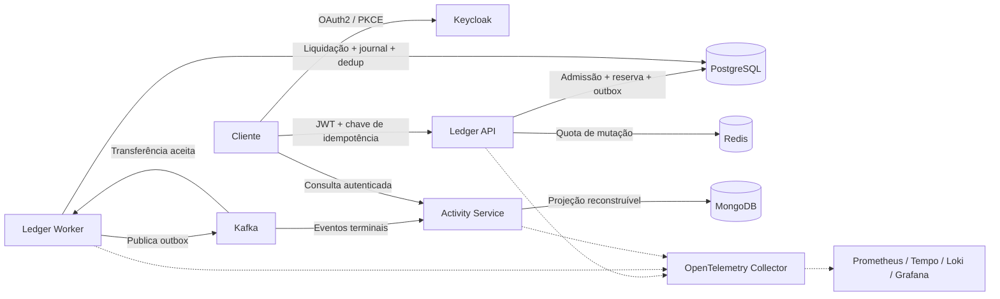

# Distributed Transaction Platform

**Um laboratório de backend distribuído em Java: manter transferências corretas mesmo com concorrência, eventos duplicados e falhas.**


Projeto pessoal de portfólio desenvolvido por [Gabriel Pereira](https://github.com/Gabriel-PereiraL). Transferências e contas são sintéticas: o objetivo é demonstrar decisões de arquitetura, invariantes financeiros e recuperação verificável. Não movimenta dinheiro real.

[Como executar](synthetic-ledger/README.md) · [Arquitetura e decisões](PROPOSTA_ARQUITETURAL.md) · [Matriz de requisitos](REQUIREMENTS_MATRIX.md) · [Validações e limites](synthetic-ledger/docs/VALIDATION_F7.md)

## O problema

Duas requisições podem disputar o último saldo. O banco pode confirmar uma operação e o broker ficar indisponível. Um consumidor pode receber novamente um evento já processado. O sistema precisa preservar saldo, reservas e lançamentos em cada um desses cenários.

O fluxo separa a aceitação da transferência (`ACCEPTED`) da liquidação (`POSTED`). PostgreSQL mantém a verdade financeira; os demais componentes têm responsabilidades explícitas.

## Arquitetura



São três executáveis com responsabilidades distintas no mesmo domínio; não há uma malha de microsserviços criada apenas para distribuir código.

| Tecnologia | Responsabilidade |
| --- | --- |
| Java 21, Spring Boot e Maven | APIs, processamento assíncrono e build modular |
| PostgreSQL, Flyway e JPA | Transações, ledger de partidas dobradas, reservas e constraints |
| Kafka | Transporte de eventos com entrega ao menos uma vez |
| MongoDB | Histórico de leitura e projeção reconstruível |
| Redis | Quotas de mutação; não é autoridade de saldo |
| Keycloak e Spring Security | OIDC/PKCE, autorização por escopo, tenant e proprietário |
| OpenTelemetry e Grafana stack | Traces, métricas, logs selecionados e alertas locais |
| Docker, Kubernetes e Helm | Laboratório isolado, probes, rollout e recuperação de pods |
| Terraform | Blueprint futuro e validação estática com providers simulados; sem cloud |

## Decisões que o código demonstra

- **Admissão atômica:** idempotência, reserva de saldo, hold e outbox na mesma transação.
- **Ledger consistente:** lançamentos balanceados, terminalização irreversível e verificações no banco.
- **Transactional outbox e deduplicação:** publicação fora da transação SQL, replay seguro e proteção contra efeito financeiro duplicado. Sem promessa de exatamente uma vez ponta a ponta.
- **Concorrência:** validação transacional e bloqueios com ordem consistente para contas disputadas.
- **Leitura separada:** Activity mantém projeção eventual; o ledger canônico continua no PostgreSQL.
- **Segurança:** isolamento de tenants/proprietários, privilégios SQL por processo e testes de TLS/SASL/ACL.
- **Falhas explícitas:** readiness separada de liveness; recuperação e requeue controlados, sem resetar offsets financeiros.

Os [ADRs](synthetic-ledger/docs/ADR-001-foundation-boundaries.md) e a [proposta arquitetural](PROPOSTA_ARQUITETURAL.md) detalham os compromissos e as alternativas.

## Evidências e estado atual

**F0–F6 concluídas localmente. F7 em fechamento; F8 pendente.** Este repositório publica o estado de desenvolvimento, não uma release final ou uma certificação para produção.

| Verificação | Resultado registrado |
| --- | --- |
| Última regressão limpa com integração | **142 testes**, zero falhas, erros ou skips: 52 unitários/slices + 90 de integração |
| Maven verify sem perfil de integração | 52 testes aprovados |
| Contratos OpenAPI e eventos reais | Aprovados |
| Benchmark local com condições equivalentes | Nove execuções / 203 transferências; [resultados e limites](synthetic-ledger/docs/BENCHMARK_F6_MATCHED.md) |
| Recuperação de backlog | 176 transferências; [evidências](synthetic-ledger/docs/BENCHMARK_F6_RECOVERY.md) |
| Kubernetes endurecido | Bootstrap, duas APIs/dois workers, PKCE, replay e recuperação de pods verificados no cenário documentado |
| Scans das quatro imagens customizadas | Zero HIGH/CRITICAL corrigíveis no escopo registrado; uso de `--ignore-unfixed` |
| Helm / Terraform estático | Lint/render e validações com provider simulado aprovados |

As falhas também fazem parte das evidências: [saturação no benchmark](synthetic-ledger/docs/BENCHMARK_F6_SATURATION.md) e [limitação de recuperação de identidade](synthetic-ledger/docs/VALIDATION_F7.md). Após reiniciar o PostgreSQL, um primeiro login OIDC retornou HTTP 400; uma tentativa posterior passou. Isso não comprova recuperação transparente. Uma nova medição ficou pendente após falta de recursos no computador de laboratório.

Os benchmarks F6 antecedem os patches de segurança F7 e não representam capacidade de produção. A checagem de troca de API mediu 100 leituras de health, não transferências em voo. O kind local não comprova aplicação de NetworkPolicy, backup/restore ou disponibilidade entre zonas. Execução hospedada do CI e CodeQL deve ser consultada separadamente; os resultados locais não a substituem.

## Executar os testes

Pré-requisitos: **JDK 21**, Git e Docker Engine/Desktop para os testes de integração. O Maven Wrapper baixa a versão fixada; não é necessário Maven global. A primeira execução precisa de acesso às dependências e imagens.

```bash
git clone https://github.com/Gabriel-PereiraL/distributed-transaction-platform.git
cd distributed-transaction-platform/synthetic-ledger

# Linux/macOS
chmod +x mvnw
./mvnw -B -ntp clean verify -Pintegration

# Windows PowerShell
./mvnw.cmd -B -ntp clean verify -Pintegration
```

Para testes unitários e slices: execute `verify` sem `-Pintegration`. O perfil de integração cria dependências descartáveis e dados sintéticos. Os benchmarks são opt-in e ficam fora da regressão normal.

A demo completa precisa de configuração local e segredos gerados, que não estão versionados. Siga o [guia da aplicação](synthetic-ledger/README.md), o [runbook de infraestrutura](synthetic-ledger/docs/RUNBOOK_F7.md) e o [runbook de observabilidade](synthetic-ledger/docs/RUNBOOK_F5.md). Compose e kind usam portas locais iguais; execute um ambiente de cada vez. Planeje recursos para JVMs, bancos, broker e observabilidade no mesmo computador.

## Navegar pelo projeto

```text
synthetic-ledger/
  ledger-domain/       Regras de domínio
  ledger-application/  Casos de uso e portas
  ledger-adapters/     Persistência e integrações
  ledger-api/          Admissão e leitura canônica HTTP
  ledger-worker/       Outbox, liquidação e recuperação
  activity-service/    Projeção e consulta de histórico
  event-contracts/     Contratos compartilhados
  contracts/          OpenAPI e schemas de eventos
  infra/              Containers, Helm, observabilidade e Terraform estático
  scripts/            Validação, smoke e diagnóstico local
  docs/               ADRs, runbooks e evidências sanitizadas
```

## Próximos passos

- Concluir as validações finais de infraestrutura e a medição de recuperação de identidade (F7).
- Reproduzir a demonstração integrada, revisar segurança e auditar a matriz de requisitos (F8).
- Consolidar a release de portfólio com resultados e riscos residuais documentados.

Não há deploy AWS, recursos cloud criados nem credenciais de produção neste projeto. A integração com projetos anteriores é limitada e somente leitura; nenhum Fulfillment Hub é alterado pelos testes deste laboratório.
